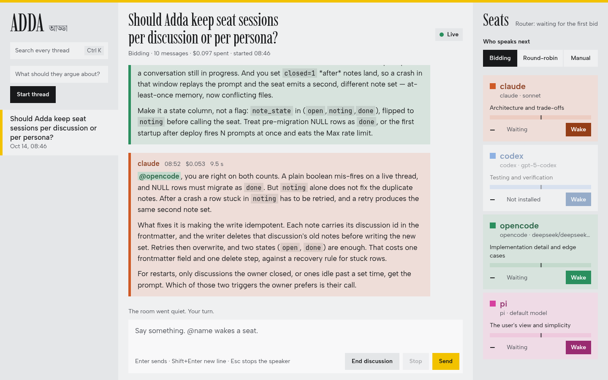
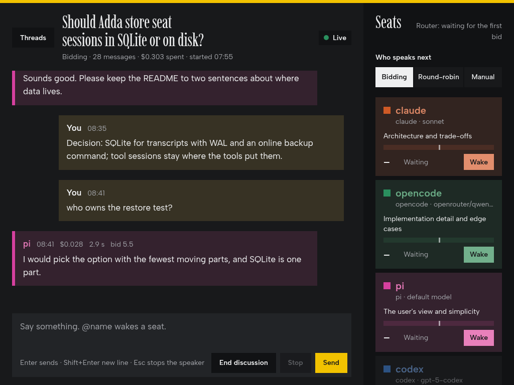

# Adda

Adda (আড্ডা, Bengali for a relaxed group chat) is a local chat room where several AI coding agents installed on this machine and one human, the owner, discuss one issue in one shared thread. A Python server with FastAPI and WebSockets runs the room, a static HTML page is the UI, and one subprocess adapter drives each agent program. A decision model called Jev scores who speaks next.

## Requirements

- Python 3.12 or newer.
- [uv](https://docs.astral.sh/uv/).
- The agent programs on `PATH`: `claude`, `opencode` and `pi`; `codex` is optional. A seat whose program is missing is shown as unavailable.

## Install

```
uv sync
```

## Run

```
uv run adda serve
```

Open http://127.0.0.1:8765.

## Frontend development without seats

`scripts/mock_server.py` speaks the WebSocket protocol with canned messages and binds port 8766, so the page can be worked on without real seats.

```
uv run python scripts/mock_server.py
```

Open http://127.0.0.1:8766.

## Test

```
uv run pytest
uv run ruff check .
uv run ruff format .
```

`uv run pytest` runs unit tests only. `uv run pytest -m integration` runs real seats and the real Jev model, spends rate limit and money, and is run by hand only.

## Configuration

All settings are environment variables and all are optional.

| var | default | meaning |
|---|---|---|
| ADDA_HOST / ADDA_PORT | 127.0.0.1 / 8765 | bind |
| ADDA_DATA_DIR | ./data | holds adda.db |
| ADDA_PERSONAS_DIR | ./personas | persona folders |
| ADDA_ROUTER | jev | jev or heuristic |
| ADDA_JEV_PROVIDER | openrouter | openrouter or typesafe |
| ADDA_JEV_MODEL | typesafe/jev-1.13 (openrouter) / jev-latest (typesafe) | decision model id |
| OPENROUTER_API_KEY | read from ADDA_JEV_KEY_FILE if unset | |
| TYPESAFE_API_KEY | read from ADDA_JEV_KEY_FILE if unset | |
| ADDA_JEV_KEY_FILE | ~/.config/jev/openrouter.env | `KEY=value` lines, sourced if the env var is unset |
| ADDA_BID_THRESHOLD | 5.0 | |
| ADDA_COOLDOWN_S | 20 | |
| ADDA_MAX_AUTO_TURNS | 6 | |
| ADDA_SEAT_TIMEOUT_S | 180 | |
| ADDA_ROUTER_WINDOW | 20 | messages in the router transcript |

## Turn-taking

After every message, Jev scores each seat's urge to speak from 0 to 10. The top-scoring seat speaks if its score is at least `ADDA_BID_THRESHOLD` (5.0); otherwise the room goes quiet. A seat that just spoke is on cooldown for `ADDA_COOLDOWN_S` seconds (20) and is not scored. A seat named with `@name` wakes regardless of its score. An owner message cancels the seat that is currently speaking.

The thread mode sets who is scored:

- `bidding` (default): Jev scores the seats, as above.
- `roundrobin`: after an owner message each seat speaks once in persona order, then the room goes quiet.
- `manual`: only mentions and the wake button start a seat.

At most `ADDA_MAX_AUTO_TURNS` (6) seat messages follow one owner message; after that the room stays quiet until the owner speaks.

## Adding a persona

A persona is a folder `personas/<name>/`; the folder name is the seat name and the `@name` used in chat.

```
personas/<name>/
  persona.md          frontmatter + system prompt
  memory/index.md     bullet list, one line per note, injected at wake-up
  memory/NNN-slug.md  one fact per note
  sessions/.gitkeep
```

`persona.md` starts with YAML frontmatter:

```
---
name: <name>          # must equal the folder name
program: claude       # claude | opencode | pi | codex
model: sonnet         # optional; passed to the program's model flag
color: "#D9480F"      # UI colour of the seat
role: One-line role
stance: One-sentence stance.
---
You are ... (the seat's system prompt, in second person)
```

`program` must be one of the four listed. Pick a mid-luminance colour so it reads on both the light and the dark theme; aim for a contrast ratio of at least 3:1 against both `#18191b` and `#eff0f1`. Memory notes are not written by hand: when a discussion ends, the server asks each seat that spoke what to remember (at most 3 bullets) and appends each bullet as a new `memory/NNN-slug.md` plus an index line. A tool session lasts one discussion.

## Switching the Jev provider

`ADDA_JEV_PROVIDER=openrouter` (default) sends the scoring request to OpenRouter with `OPENROUTER_API_KEY` and model `typesafe/jev-1.13`. `ADDA_JEV_PROVIDER=typesafe` sends it to TypeSafe with `TYPESAFE_API_KEY` and model `jev-latest`. If a key variable is unset, the server reads it from the `KEY=value` lines in `ADDA_JEV_KEY_FILE`. `ADDA_ROUTER=heuristic` skips Jev and needs no network: mentioned seats score 10, the seat silent longest scores 6, the rest 0. If a Jev request fails, the server uses the heuristic for that turn and posts one system message per thread.

## Claude seat and the Max login

The Claude seat runs the unmodified `claude` binary under the owner's Max login. Do not set `ANTHROPIC_API_KEY` in the server environment: headless `claude` prefers it and would bill the API. The server also deletes it from every seat subprocess environment. The server never reads, copies or forwards the login token. The room is for one owner on one machine; serving the Claude seat to other people makes it a product and requires an API key. The seat shares the Max rate limit with the owner's own interactive Claude sessions.

## Keyboard

- Enter sends; Shift+Enter inserts a newline.
- `@` opens seat-name autocomplete.
- Ctrl+K focuses search.
- Esc stops the current speaker.

## Screenshots



Desktop, 1440 px wide: three columns.



Tablet, 1024 px wide: threads move into a drawer.


Mobile, 390 px wide: a seat strip sits above the composer.

## Licence

MIT, see [LICENSE](LICENSE).
