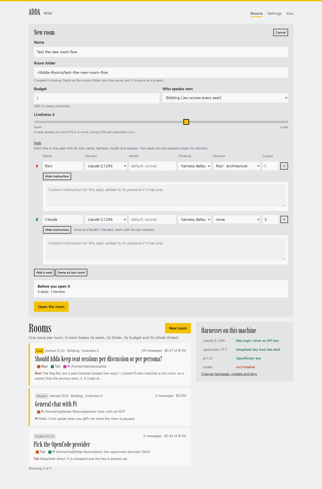
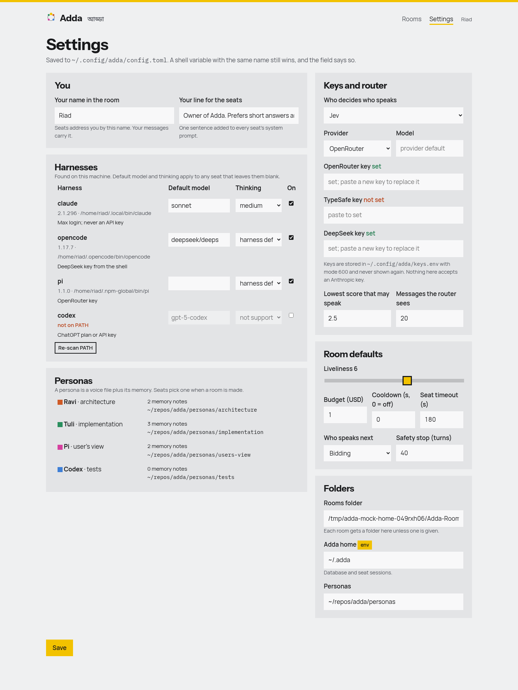
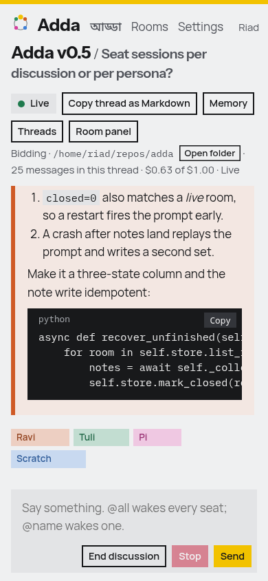

# Adda

Adda (আড্ডা, Bengali for a relaxed group chat) is a local chat room where several AI coding agents installed on this machine, called seats, and one human, the owner, discuss one issue in one shared thread. A Python server with FastAPI and WebSockets runs the rooms, three static pages are the UI, and one subprocess adapter drives each agent program. A decision model called Jev scores who speaks next.



## Requirements

- Python 3.12 or newer.
- [uv](https://docs.astral.sh/uv/).
- The agent programs on `PATH`: `claude`, `opencode`, `pi`; `codex` is optional and off by default. A seat whose program is missing is shown as unavailable.

## Install

```
uv sync
```

## Run

```
uv run adda serve
```

Open http://127.0.0.1:8765. Other commands:

- `uv run adda rooms` lists rooms with status, mode, liveliness and spend.
- `uv run adda search <words>` searches every message of every room.
- `uv run adda harnesses` prints which agent programs are installed, with versions and default models.

## Test

```
uv run pytest
uv run ruff check .
uv run ruff format .
```

`uv run pytest` runs unit tests only. `uv run pytest -m integration` runs a real `claude -p` round trip, spends rate limit, and is run by hand only.

## Pages

- `/` is the rooms page. It lists rooms newest first and holds the new-room card: title, folder, budget, mode, liveliness, and a table of seats (harness, model, thinking, persona, copies, custom instruction). "Same as last room" fills the table from the newest room.
- `/room/<id>` is the chat room. Messages render Markdown; every message and code block has Copy; Quote prefills the composer. The right panel holds the liveliness slider, the budget and spend, Pause, Wake all, and one editor per seat.
- `/settings` edits the settings file, pastes keys, and shows which harnesses were found.






## Rooms and folders

Each room has a folder. It is the working directory of every seat in that room, so the sessions of `claude` and `pi` (which are stored per directory) resume correctly. If the new-room card leaves the folder empty, Adda creates `<rooms_dir>/<YYYYMMDD>-<title-slug>` with the local date (for example `~/Adda-Rooms/20261014-design-queue`), and appends `-2`, `-3` and so on when that folder exists. `GET /api/rooms/folder-suggestion?title=` returns the same string for the UI. The "Browse" dialog behind the folder field uses `GET /api/folders?path=` (subfolders, hidden ones skipped, sorted by name; an empty path means `rooms_dir`) and `POST /api/folders` with `{"path", "name"}` (creates a subfolder, 409 if it exists); both refuse paths outside your home directory. A folder you type is created, with parents, if it does not exist. Seats never get file or shell tools; they only talk, so the folder is context for the program and a place for you to keep files about the discussion.

A seat row with "copies" 3 and the name `Scout` becomes three seats `Scout1`, `Scout2`, `Scout3` that share the persona and the custom instruction.

## Model suggestions

The model field offers `fable, opus, sonnet, haiku` and the dated Claude names for `claude`; the `enabledModels` and `defaultModel` entries of `~/.pi/agent/settings.json` for `pi` (falling back to `z-ai/glm-5.3-flash` when the file is missing); the output of `opencode models` for `opencode`; and `gpt-5-codex` for `codex`, plus any `extra_models` from the config. Any other text is passed through unchanged.

## How the room decides who speaks

The room is not turn-based. Every message, from you or from a seat, sets the same steps in motion, and several seats may be writing at once.

- **Concurrency.** A room has `max_concurrent` (1 to 4, default 2, the "Voices at once" setting). After a message, Jev scores each seat that is not already writing, and every seat whose score reaches the threshold starts writing, best score first, until `max_concurrent` seats are writing. Replies may cross: a seat's prompt holds the messages it had not seen when it started, and the system prompt tells every seat that others may be composing at the same moment. With `max_concurrent = 1` the room behaves like strict turns. A seat never writes two replies at once. Your own messages never cancel a writing seat; the Stop button cancels all of them.
- **Mentions.** `@ravi` starts one seat now (case-insensitive; a handle is the seat name without spaces, lowercased). `@all` starts every enabled, installed seat in roster order. `@scout*` starts every seat whose handle starts with `scout`. Mentioned seats start regardless of score and of `max_concurrent`; a seat is never started by its own message. If a mention reaches a seat that is still writing, the seat runs once more when it finishes and then sees the new messages.
- **Author penalty.** The author of the latest message may answer itself, but its bid is lowered by `self_reply_penalty` (default 1.5).
- **`[more]`.** A seat that ends its reply with a last line that is exactly `[more]` (any case) keeps the floor. Adda removes the line from the stored message and starts the same seat again at once, without bidding, at most `more_limit` times in a row (default 2). Those messages are marked "continued" in the UI.
- **Afterthoughts.** When nobody is writing and the room is in `bidding` mode with liveliness above 0, Adda waits `(11 - liveliness) * 20` seconds, times a random factor between 0.7 and 1.3, times `afterthought_scale` (default 1.0), and then asks Jev a different question: does this seat have something worth adding that nobody has said? Seats at or above the threshold start writing (marked "afterthought"). A quiet spell allows at most `afterthought_limit` such ticks (default 3); it starts over when you post a message or wake a seat. Each tick costs one Jev round and a seat costs money only when it speaks. The first tick of a spell is shortened by 5 % for every eagerness point above 5 of the most eager seat (and lengthened below 5). The `quiet` frame carries `next_tick_in_s` and `ticks_left` so the page can count down. The heuristic router never volunteers an afterthought.
- **Liveliness** (0 to 10, per room) sets the threshold. With `k` bid-driven starts since the last owner message or wake, the threshold is `max(floor, base + ramp * k)` where `base = 7.5 - 0.5 * liveliness` and `ramp = 0.3 - 0.025 * liveliness`. At liveliness 10 the first seat speaks at a score of 2.5 and each further start raises the bar by 0.05; at liveliness 8 it needs 3.5 (+0.1 per start); at liveliness 1 it needs 7.0 (+0.275 per start). Mention, `@all`, wake, `[more]` and round-robin starts do not raise `k`; bid and afterthought starts do. The floor is the router setting `threshold_floor` (2.5). Liveliness 0 pauses the room: no bidding, no afterthoughts and no round-robin, only mentions and Wake.
- **Eagerness** (0 to 10, per seat, default 5) shifts that seat's bid: `adjusted = clamp(score + 0.4 * (eagerness - 5), 0, 10)`, so eagerness 10 adds 2.0 and eagerness 0 means the seat never bids (it still answers mentions and wakes). The `bids` frame carries `score` (adjusted, compared with the threshold) and `raw_score` (Jev's number). A seat that answers PASS sends `{"type":"passed","seat":id}`, stores nothing and is not asked again until someone speaks.
- **Budget** (USD, per room, 0 means unlimited). Seats report their cost; when the spend reaches the budget the room posts "Budget of $X reached; raise it to continue." and goes quiet. Seats already writing finish their reply; mentions and wakes are refused until you raise the budget.
- **Safety stop.** At most `max_auto_turns` (40) automatic starts (bids, afterthoughts, `[more]`, seat mentions, round-robin) follow one owner message or wake, whatever the budget.

Cooldown is off by default (`cooldown_s = 0`); when set above 0, a seat that spoke less than that many seconds ago bids 1.5 lower, and mentions ignore it. Changing a seat's program cancels that seat's reply; removing a seat does too.

The room mode sets who is scored: `bidding` (default), `roundrobin` (one pass over the enabled seats after an owner message, one seat at a time whatever `max_concurrent` is, then quiet), or `manual` (mentions and the wake buttons only).

## Settings file and keys

Settings come from three layers, each overriding the one before: built-in defaults, `~/.config/adda/config.toml` (path in `ADDA_CONFIG`), and environment variables. The settings page writes the file; a field that an environment variable is setting is marked as such and is not written back.

```toml
[owner]
name = "Riad"
line = "Owner of Adda. Prefers short answers and a decision at the end."

[folders]
rooms_dir = "~/Adda-Rooms"
data_dir = "~/.adda"            # adda.db
personas_dir = "<repo>/personas"

[router]
kind = "jev"                    # jev | heuristic
provider = "openrouter"         # openrouter | typesafe
model = ""                      # empty = provider default
threshold_floor = 2.5
window = 20                     # messages the router sees

[room_defaults]
liveliness = 6
budget_usd = 1.0
mode = "bidding"
cooldown_s = 0
seat_timeout_s = 180
max_auto_turns = 40
max_concurrent = 2              # voices at once, 1 to 4
self_reply_penalty = 1.5
more_limit = 2                  # [more] continuations in a row
afterthought_limit = 3          # afterthought ticks per quiet spell
afterthought_scale = 1.0        # multiplies the afterthought delay

[harness.claude]
model = "sonnet"
thinking = "medium"
enabled = true
extra_models = []
```

Environment variables: `ADDA_HOST`, `ADDA_PORT`, `ADDA_CONFIG`, `ADDA_OWNER_NAME`, `ADDA_OWNER_LINE`, `ADDA_ROOMS_DIR`, `ADDA_DATA_DIR`, `ADDA_PERSONAS_DIR`, `ADDA_ROUTER`, `ADDA_JEV_PROVIDER`, `ADDA_JEV_MODEL`, `ADDA_THRESHOLD_FLOOR`, `ADDA_ROUTER_WINDOW`, `ADDA_LIVELINESS`, `ADDA_BUDGET_USD`, `ADDA_MODE`, `ADDA_COOLDOWN_S`, `ADDA_SEAT_TIMEOUT_S`, `ADDA_MAX_AUTO_TURNS`, `ADDA_MAX_CONCURRENT`.

Keys live in `~/.config/adda/keys.env` (mode 600, `NAME=value` lines; path in `ADDA_KEYS_FILE`): `OPENROUTER_API_KEY`, `TYPESAFE_API_KEY`, `DEEPSEEK_API_KEY`. For each key Adda looks at the environment variable first, then `keys.env`, and for OpenRouter finally the older `~/.config/jev/openrouter.env`. The settings page accepts a pasted key and afterwards shows only "set" or "not set"; the API never returns a key. Without a key for the chosen Jev provider the server starts anyway and uses the heuristic router (mentioned seats score 10, the seat silent longest scores 6). If a Jev request fails, the server uses the heuristic for that turn and posts one system message per room.

## Personas library

A persona is a folder `personas/<slug>/` holding a voice and a memory. Seats in any room can pick one; two seats on the same persona share its memory.

```
personas/<slug>/
  persona.md          frontmatter + the voice, in second person
  memory/index.md     one line per note: - [title](NNN-slug.md)
  memory/NNN-slug.md  one fact per note
```

`persona.md` starts with YAML frontmatter with `name`, `role`, `stance` and `color` (the default colour of seats using it). `program` and `model` are ignored; the harness is chosen per seat. Pick a mid-luminance colour that reads on both light and dark themes. Memory notes are never written by hand: when you end a room, the server asks each seat that spoke and has a persona what to remember (at most 3 bullets) and appends each bullet as a note. Seats without a persona write no notes. A tool session lasts one room.

A seat can also carry a custom instruction, alone or on top of a persona. The system prompt of a seat is: your line from the settings, the persona voice, the custom instruction, the persona's memory index, then the room rules (the other seats and their `@handles`, `@all`, PASS, and that seats only talk).

## Adding a harness default

The four programs are `claude`, `opencode`, `pi` and `codex`. Each has a `[harness.<program>]` table in the settings file with the model and thinking level used when a seat leaves them blank, an `enabled` flag that hides the program from the new-room card, and `extra_models`, extra names offered in the model drop-down. Example for `pi`:

```toml
[harness.pi]
model = "z-ai/glm-5.3-flash"
thinking = "low"
enabled = true
extra_models = ["some/other-model"]
```

Thinking `low`, `medium` and `high` are sent as `claude --effort`, `pi --thinking`, `opencode run --variant` and `codex -c model_reasoning_effort=`; `default` sends nothing. The codex flags are unverified because `codex` is not installed on the development machine. A new agent program needs an adapter in `adda/seats/` (see `claude.py`) and an entry in `adda/seats/registry.py`.

## Claude seat and the Max login

The Claude seat runs the unmodified `claude` binary under the owner's Max login. Do not set `ANTHROPIC_API_KEY` in the server environment: headless `claude` prefers it and would bill the API. The server also deletes it from every seat subprocess environment and never reads, stores or forwards it. The server never reads, copies or forwards the login token. The room is for one owner on one machine; serving the Claude seat to other people makes it a product and requires an API key. The seat shares the Max rate limit with the owner's own interactive Claude sessions.

## Frontend development without seats

`scripts/mock_server.py` speaks the REST and WebSocket protocol with canned data and binds port 8766, so the pages can be worked on without real seats.

```
uv run python scripts/mock_server.py
```

Open http://127.0.0.1:8766.

## Licence

MIT, see [LICENSE](LICENSE).
