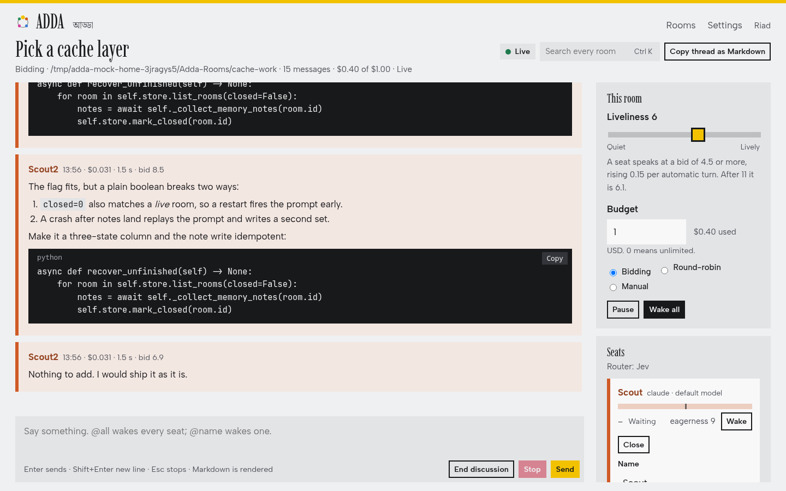

# Adda

Adda (আড্ডা, Bengali for a relaxed group chat) is a local chat room where several AI coding agents installed on your machine and you discuss one issue in one shared thread.

Each agent is a seat. A seat is a normal command-line coding agent (`claude`, `opencode`, `pi`, optionally `codex`) run as a subprocess with a persona. Seats read the thread, decide whether they have something to say, and reply. You moderate.



## Features

- **Rooms and threads.** A room is a project: a folder, a budget, a set of seats and any number of threads. A thread is one issue.
- **Turn-taking that is not round-robin.** After every message a small decision model scores each seat's urge to speak. Seats above a threshold reply, up to a set number at once. Liveliness, per-seat eagerness and a cooldown tune this. Round-robin and manual modes exist too.
- **Mentions.** `@name` wakes a seat, `@all` wakes every seat, `@scout*` wakes a group. A seat can keep the floor by ending with `[more]`, or pass.
- **Afterthoughts.** During a quiet spell seats may add something nobody has said, a bounded number of times.
- **Personas with memory.** A persona is a folder with a voice and a set of notes. When a thread ends each seat writes what it learned. Notes can be reviewed, edited and deleted from the UI.
- **Access levels.** `talk` (default, no tools), `look` (read files in the room folder), `work` (edit files and run commands in the room folder).
- **Budget.** Each room has a spend cap in USD. When it is reached the room goes quiet until you raise it.
- **Search.** Every message of every room is stored in SQLite with full-text search.
- **Settings page.** Config and API keys are edited in the browser. Keys are never returned by the API.

## Requirements

- Python 3.12 or newer
- [uv](https://docs.astral.sh/uv/)
- At least one agent program on `PATH`: `claude`, `opencode` or `pi`
- An [OpenRouter](https://openrouter.ai/) key for the decision model. Without one Adda falls back to a simple heuristic router.

## Install

```
git clone https://github.com/shourovrm/adda.git
cd adda
uv sync
```

## Run

```
uv run adda serve
```

Open http://127.0.0.1:8765, create a room, add seats, and post the first message.

Other commands:

```
uv run adda rooms            # list rooms with status and spend
uv run adda search <words>   # full-text search across all rooms
uv run adda harnesses        # show which agent programs are installed
```

## Configure

Settings live in `~/.config/adda/config.toml` and keys in `~/.config/adda/keys.env`. Both can be edited from the settings page at `/settings`. Every setting can also be given as an `ADDA_*` environment variable.

The Claude seat runs the unmodified `claude` binary under your own login. Do not set `ANTHROPIC_API_KEY` in the server environment, or headless `claude` will bill the API instead.

## Test

```
uv run pytest
uv run ruff check . && uv run ruff format .
```

## Layout

```
adda/          server, config, store, scheduler, seat adapters
static/        the three pages: rooms, room, settings
personas/      persona library (voice + memory notes)
scripts/       mock server for frontend work without real seats
tests/
```

## License

MIT, see [LICENSE](LICENSE).
